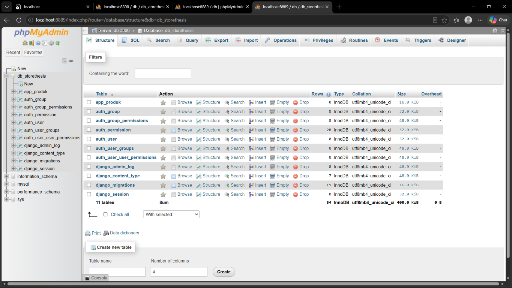
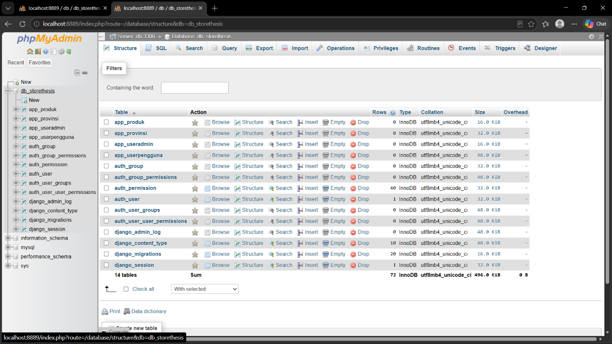
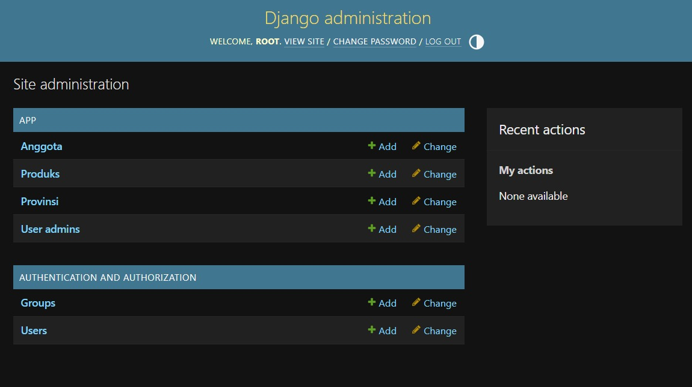
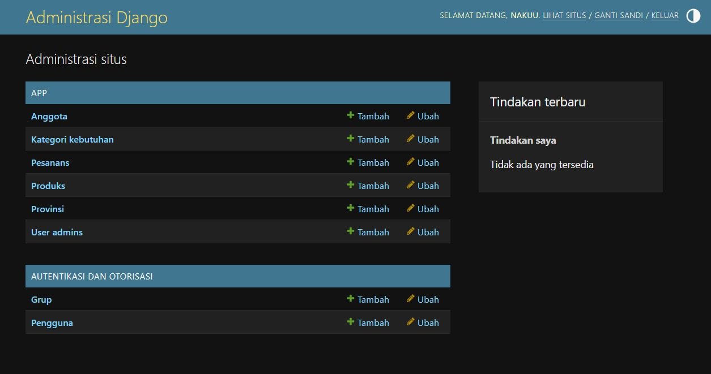
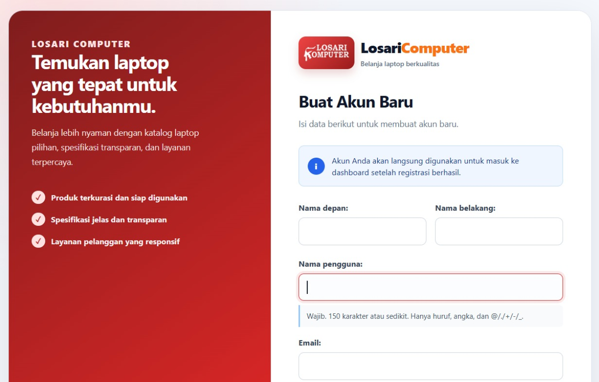
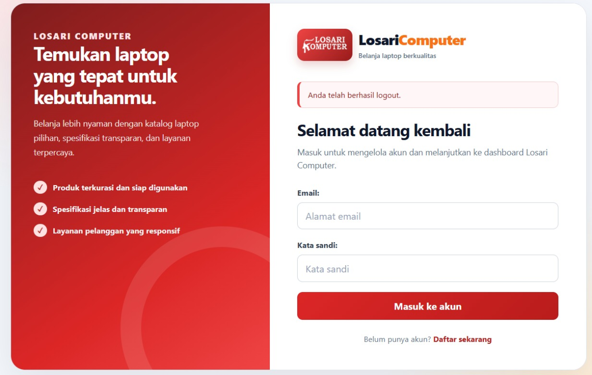
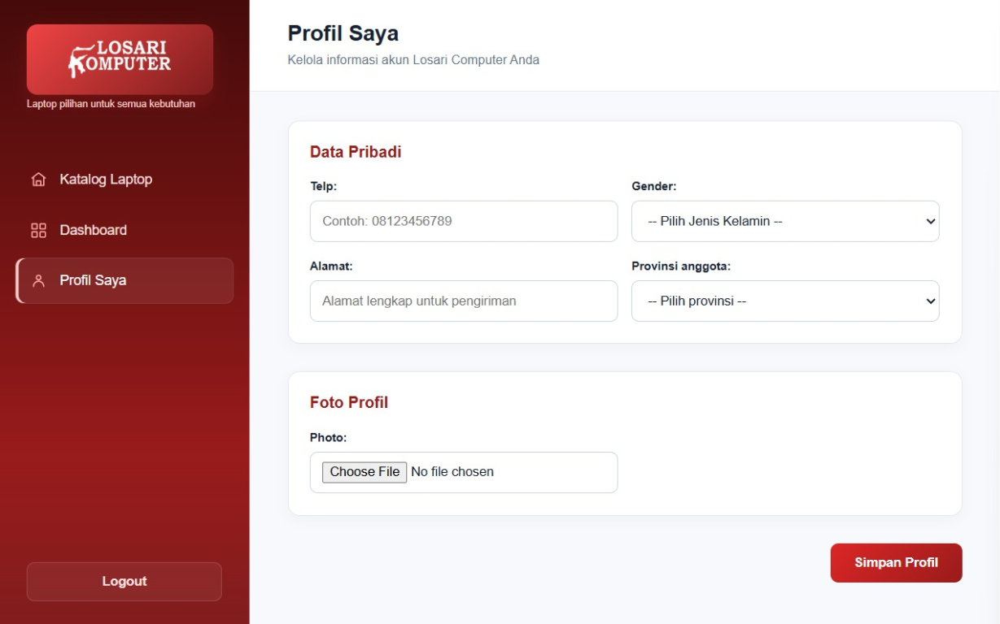
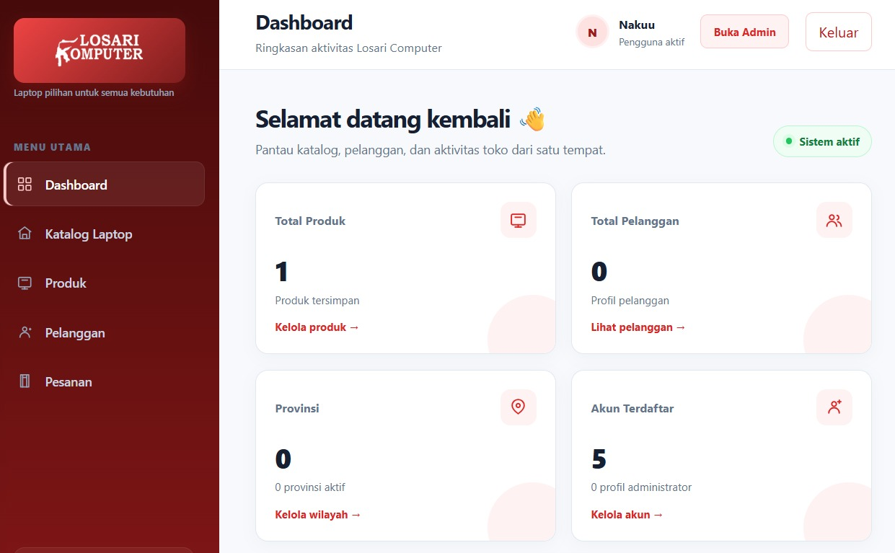

# Losari Computer

## Kelompok 9

| No. | Nama Lengkap | NIM |
|---:|---|---|
| 1 | Muhammad Fauzan Ali Fatah | 240907500027 |
| 2 | Husnul Nadya F | 240907502036 |
| 3 | Firman | 240907501044 |
| 4 | Ahmad Naufal Dzaky | 240907502037 |

## Daftar Isi

1. [Gambaran Umum](#1-gambaran-umum)
2. [Struktur Direktori](#2-struktur-direktori)
3. [Model Produk](#3-model-produk)
4. [Database dan Docker](#4-database-dan-docker)
5. [Menyiapkan dan Menjalankan Proyek](#5-menyiapkan-dan-menjalankan-proyek)
   - [Hasil Tambahkan](#hasil-tambahkan)
6. [Migrasi Database](#6-migrasi-database)
7. [Django Administration](#7-django-administration)
8. [Dashboard Aplikasi](#8-dashboard-aplikasi)
   - [Dokumentasi Visual Tahapan](#dokumentasi-visual-tahapan)
9. [Konfigurasi Dependency](#9-konfigurasi-dependency)
10. [Menghindari Konflik Port](#10-menghindari-konflik-port)
11. [Pengembangan Berikutnya](#11-pengembangan-berikutnya)
12. [Ringkasan Perintah](#12-ringkasan-perintah)

## 1. Gambaran Umum

Losari Computer adalah aplikasi e-commerce berbasis Django. Proyek ini
menggunakan MariaDB sebagai database dan phpMyAdmin sebagai alat bantu untuk
melihat serta mengelola database melalui browser.

Pada kondisi saat ini, proyek sudah memiliki:

- konfigurasi proyek Django;
- aplikasi Django bernama `app`;
- model `Kategori`, `Produk`, `Pesanan`, `ItemPesanan`, `Provinsi`, `UserAdmin`,
  dan `UserPengguna`;
- autentikasi pengguna dan administrator;
- dashboard aplikasi untuk melihat ringkasan data;
- halaman Django Administration untuk mengelola data;
- service MariaDB dan phpMyAdmin melalui Docker Compose;
- konfigurasi koneksi Django ke MariaDB.

Pengelolaan data dilakukan melalui dashboard aplikasi dan Django
Administration. Pengembangan katalog e-commerce dapat dilanjutkan dengan
menambahkan field produk seperti harga, stok, deskripsi, dan gambar.

## 2. Struktur Direktori

```text
thesisstore/
├── manage.py
├── requirements.txt
├── compose.yaml
├── db.sqlite3
├── core/
│   ├── settings.py
│   ├── urls.py
│   ├── asgi.py
│   └── wsgi.py
└── app/
    ├── models.py
    ├── views.py
    ├── urls.py
    ├── admin.py
    ├── tests.py
    └── migrations/
        ├── 0001_initial.py
        └── __init__.py
```

### Tabel katalog e-commerce

Migration katalog sudah tersedia pada `app/migrations/0003_*.py` dan
`app/migrations/0004_default_categories.py`. Setelah migration dijalankan pada
MariaDB, tabel berikut akan terlihat di phpMyAdmin:

| Model Django | Tabel MariaDB |
|---|---|
| `Kategori` | `app_kategori` |
| `Produk` | `app_produk` |
| `Pesanan` | `app_pesanan` |
| `ItemPesanan` | `app_itempesanan` |

Nama tabel `app_pesanan` memakai bentuk tunggal karena mengikuti nama model
`Pesanan`; menu admin boleh menampilkan label jamak “Pesanans”.

### Penjelasan file penting

- `manage.py`: menjalankan perintah administrasi Django, misalnya migrasi dan
  server development.
- `core/settings.py`: konfigurasi utama proyek, termasuk aplikasi terpasang,
  database, middleware, dan pengaturan bahasa.
- `core/urls.py`: URL utama proyek. Saat ini menyediakan `/admin/` dan
  meneruskan URL dengan awalan `/app/` ke aplikasi `app`.
- `app/models.py`: definisi struktur data aplikasi.
- `app/views.py`: logika dashboard, katalog, pencarian, dan detail produk.
- `app/urls.py`: URL dashboard, autentikasi, profil, katalog, dan detail produk.
- `app/admin.py`: konfigurasi pengelolaan kategori, produk, pesanan, profil,
  dan data pengguna melalui Django Admin.
- `app/migrations/0003_*.py`: migrasi skema katalog e-commerce.
- `app/migrations/0004_default_categories.py`: data awal empat kategori
  kebutuhan laptop.
- `compose.yaml`: definisi container MariaDB dan phpMyAdmin.
- `requirements.txt`: dependency Python yang diperlukan proyek.

## 3. Model Produk dan Pesanan

Model katalog dirancang untuk mendukung alur toko laptop:

| Model | Fungsi |
|---|---|
| `Kategori` | Mengelompokkan laptop berdasarkan Office & Kuliah, Desain & Kreatif, Gaming, dan Bisnis |
| `Produk` | Menyimpan nama, slug, merek, harga, stok, kondisi, gambar, dan spesifikasi |
| `Pesanan` | Menyimpan pelanggan, status, alamat pengiriman, total, dan waktu transaksi |
| `ItemPesanan` | Menyimpan produk, jumlah, serta snapshot harga dan nama saat dipesan |

Relasi utama:

```text
Kategori 1 ──── * Produk
User     1 ──── * Pesanan
Pesanan  1 ──── * ItemPesanan
Produk   1 ──── * ItemPesanan
```

`ItemPesanan` menyimpan `nama_produk` dan `harga_satuan` sebagai snapshot agar
riwayat transaksi tetap benar walaupun nama atau harga produk berubah di
kemudian hari.

## 4. Database dan Docker

File `compose.yaml` menjalankan dua service:

### Service `db`

- Image: `mariadb:10.11.15`
- Nama database: `db_losarikomputer`
- User aplikasi: `thesistore_user`
- Password user aplikasi: `thesistore_pass`
- Password root: `rootpassword`
- Port host: `3312`
- Port di dalam jaringan Docker: `3306`

Format port berikut:

```yaml
"3312:3306"
```

berarti port `3312` pada Windows diteruskan ke port `3306` di dalam container
MariaDB.

### Service `phpmyadmin`

- Image: `phpmyadmin:latest`
- Host database Docker: `db`
- Port database Docker: `3306`
- Port browser pada host: `8890`

Format port berikut:

```yaml
"8890:80"
```

berarti phpMyAdmin dapat dibuka pada port `8890` di Windows, sedangkan Apache
di dalam container mendengarkan pada port `80`.

Nama `db` pada `PMA_HOST` bukan `localhost`. Karena phpMyAdmin dan MariaDB
berjalan pada network Docker yang sama, phpMyAdmin mengakses MariaDB melalui
nama service `db`.

Volume `db_data` menyimpan data MariaDB agar data tidak hilang ketika container
dihentikan atau dibuat ulang. Network `thesistore_network` memungkinkan service
`db` dan `phpmyadmin` saling berkomunikasi.

## 5. Menyiapkan dan Menjalankan Proyek

### Prasyarat

Pastikan sudah tersedia:

- Docker Desktop;
- Python;
- virtual environment Python;
- PowerShell pada Windows.

### Menjalankan container

Buka PowerShell pada direktori proyek:

```powershell
cd "D:\UCANG SEMESTER 5\E-COMMERCE\thesisstore"
docker compose up -d
```

Periksa status service:

```powershell
docker compose ps
```

Kedua service harus berstatus `Up`.

### Membuka phpMyAdmin

Buka alamat berikut pada browser:

```text
http://localhost:8890
```

Gunakan data login:

```text
Server: db
Username: root
Password: rootpassword
```

Database `db_losarikomputer` seharusnya terlihat pada panel kiri phpMyAdmin.

### Output phpMyAdmin

Berikut adalah hasil saat database `db_losarikomputer` berhasil dibuka melalui
phpMyAdmin pada `http://localhost:8890`. Tampilan ini menunjukkan tabel
`app_produk` dan tabel bawaan Django seperti tabel autentikasi, migrasi, dan
session.



Pada gambar tersebut:

- `db_losarikomputer` adalah database yang digunakan oleh proyek;
- `app_produk` adalah tabel yang dibuat dari model `Produk`;
- tabel `auth_*` digunakan oleh sistem autentikasi Django;
- `django_migrations` menyimpan catatan migrasi yang sudah diterapkan;
- `django_session` menyimpan data session Django.

### Hasil tambahkan

Deskripsi: **hasil tambahkan**

1. `app_provinsi`
2. `app_useradmin`



### Menjalankan Django

Aktifkan virtual environment:

```powershell
.\venvku\Scripts\Activate.ps1
```

Jika PowerShell menolak script karena execution policy, jalankan Python secara
langsung tanpa aktivasi:

```powershell
.\venvku\Scripts\python.exe manage.py runserver
```

Jika virtual environment sudah aktif, perintahnya:

```powershell
python manage.py runserver
```

Buka aplikasi pada:

```text
http://127.0.0.1:8000/
```

## 6. Migrasi Database

Migrasi adalah mekanisme Django untuk mengubah definisi model Python menjadi
struktur tabel database.

Setelah mengubah `app/models.py`, buat migrasi baru:

```powershell
.\venvku\Scripts\python.exe manage.py makemigrations
```

Terapkan migrasi ke MariaDB:

```powershell
.\venvku\Scripts\python.exe manage.py migrate
```

Periksa status migrasi:

```powershell
.\venvku\Scripts\python.exe manage.py showmigrations
```

Tanda `[X]` berarti migrasi sudah diterapkan. Pesan `No migrations to apply`
berarti tidak ada migrasi baru yang perlu dijalankan; pesan tersebut bukan
error.

Penting: konfigurasi pada `core/settings.py` menggunakan MariaDB:

```python
'HOST': '127.0.0.1',
'PORT': '3312',
```

Karena itu, Django harus dijalankan ketika container database aktif. File
`db.sqlite3` tidak digunakan oleh konfigurasi database saat ini.

## 7. Django Administration

Django Administration adalah panel bawaan Django untuk mengelola data aplikasi
melalui browser. Pada proyek ini, panel tersebut tersedia pada:

```text
http://127.0.0.1:8000/admin/
```

Screenshot berikut menunjukkan halaman Django Administration setelah model
aplikasi berhasil ditambahkan. Menu yang tersedia meliputi `Anggota`,
`Produks`, `Provinsi`, dan `User admins`, serta menu autentikasi Django.



Pada halaman tersebut, administrator dapat:

- membuka menu `Anggota` untuk mengelola data pengguna;
- menambah dan mengubah data `Produk`;
- mengelola data `Provinsi`;
- mengelola profil `User admins`;
- mengatur akun melalui menu `Users`;
- mengatur kelompok hak akses melalui menu `Groups`;
- melihat aktivitas administrator pada panel `Recent actions`.

Server Django harus tetap berjalan agar halaman admin dapat dibuka. Jalankan
server dengan:

```powershell
.\venvku\Scripts\python.exe manage.py runserver 127.0.0.1:8000
```

Jika browser menampilkan `ERR_CONNECTION_REFUSED`, biasanya tidak ada proses
Django yang sedang mendengarkan pada port `8000`. Pastikan perintah
`runserver` masih berjalan dan gunakan alamat yang sesuai.

### Membuat akun administrator

Buat akun superuser menggunakan perintah berikut:

```powershell
.\venvku\Scripts\python.exe manage.py createsuperuser
```

Isi username, alamat email, dan password ketika diminta. Akun tersebut
digunakan untuk login ke Django Administration. Jika password yang dimasukkan
dua kali berbeda, Django akan meminta pengulangan password.

### Mendaftarkan model ke admin

Model hanya tampil di panel admin setelah didaftarkan pada `app/admin.py`.
Model katalog saat ini sudah didaftarkan melalui `ModelAdmin` agar tersedia
fitur pencarian, filter, slug otomatis, dan inline item pesanan.

```python
from django.contrib import admin
from .models import ItemPesanan, Kategori, Pesanan, Produk

admin.site.register(Kategori)
admin.site.register(Produk)
admin.site.register(Pesanan)
admin.site.register(ItemPesanan)
```

Setelah server dijalankan dan login sebagai superuser, menu `Produk` dapat
digunakan untuk menambah, mengubah, dan menghapus data produk. Perubahan data
yang dilakukan melalui admin akan tersimpan pada database yang dikonfigurasi
di `core/settings.py`.

## 8. Dashboard Aplikasi

Dashboard aplikasi dapat dibuka setelah administrator berhasil login melalui:

```text
http://127.0.0.1:8000/app/dashboard/
```

Dashboard menampilkan ringkasan data Losari Computer dalam bentuk kartu informasi:

- **Total Produk**: jumlah produk yang tersimpan;
- **Total Pelanggan**: jumlah profil pengguna;
- **Provinsi**: jumlah provinsi yang aktif;
- **Akun Terdaftar**: jumlah akun Django yang terdaftar dan jumlah profil
  administrator.

Pada panel navigasi, administrator dapat membuka menu:

- `Dashboard` untuk melihat ringkasan data;
- `Produk` untuk mengelola produk;
- `Pelanggan` untuk melihat data pelanggan;
- `Provinsi` untuk mengelola data provinsi.

Dashboard juga menyediakan tombol **Buka Admin** untuk menuju halaman Django
Administration dan tombol **Keluar** untuk mengakhiri sesi login.

Tampilan dashboard memperlihatkan status sistem, nama pengguna yang sedang
aktif, serta tautan cepat menuju data produk, anggota, dan provinsi.

### Dokumentasi Visual Tahapan

Bagian ini mendokumentasikan alur aplikasi Losari Computer dari panel
administrasi, pembuatan akun, login, pengisian profil, sampai dashboard.

#### Tahap 1 - Django Administration



Panel Django Administration digunakan oleh administrator untuk mengelola data
aplikasi. Menu katalog yang tersedia meliputi kategori kebutuhan, pesanan,
produk, provinsi, dan akun pengguna. Tombol **Tambah** digunakan untuk membuat
data baru, sedangkan **Ubah** digunakan untuk memperbarui data yang sudah ada.

#### Tahap 2 - Registrasi Pengguna



Halaman registrasi dipakai untuk membuat akun pelanggan baru. Pengguna mengisi
nama depan, nama belakang, nama pengguna, email, dan password. Setelah
registrasi berhasil, akun dapat digunakan untuk masuk ke aplikasi.

#### Tahap 3 - Login



Halaman login memvalidasi email dan password pengguna. Setelah kredensial
benar, pengguna diarahkan ke dashboard. Pesan keberhasilan atau kesalahan
ditampilkan di dalam area notifikasi agar status proses mudah dipahami.

#### Tahap 4 - Profil Pengguna



Pengguna melengkapi data nomor telepon, jenis kelamin, alamat pengiriman,
provinsi, dan foto profil. Data ini digunakan untuk melengkapi identitas
pelanggan dan mendukung proses pengiriman pesanan.

#### Tahap 5 - Dashboard Losari Computer



Dashboard menampilkan ringkasan kondisi aplikasi dalam kartu statistik:
jumlah produk, pelanggan, provinsi, dan akun terdaftar. Sidebar menyediakan
akses ke katalog, produk, pelanggan, pesanan, serta halaman administrasi.
Warna merah, logo, dan ikon SVG digunakan secara konsisten di seluruh halaman
admin dan pengguna.

## 9. Konfigurasi Dependency

Isi `requirements.txt` menyediakan:

- `Django>=5.2,<6.0`: framework web yang digunakan;
- `PyMySQL>=1.1,<2.0`: driver Python untuk koneksi MySQL/MariaDB.

Instal dependency jika diperlukan:

```powershell
.\venvku\Scripts\python.exe -m pip install -r requirements.txt
```

## 10. Menghindari Konflik Port

Satu port host tidak dapat dipakai oleh dua container secara bersamaan. Jika
muncul pesan:

```text
Bind for 0.0.0.0:8890 failed: port is already allocated
```

periksa container yang memakai port tersebut:

```powershell
docker ps --format "table {{.Names}}\t{{.Ports}}\t{{.Status}}"
```

Hentikan container lama yang tidak digunakan, misalnya:

```powershell
docker stop tes-phpmyadmin-1
```

Lalu jalankan project ini kembali:

```powershell
docker compose up -d
```

Jangan menggunakan `docker compose down -v` hanya untuk mengatasi konflik
port. Opsi `-v` dapat menghapus volume database dan data yang tersimpan di
dalamnya.

## 11. Pengembangan Berikutnya

Fitur berikut dapat ditambahkan pada tahap selanjutnya:

1. mendaftarkan `Produk` di `app/admin.py`;
2. membuat view daftar dan detail produk;
3. menambahkan route produk pada `app/urls.py`;
4. membuat template HTML;
5. menambahkan field seperti harga, stok, deskripsi, dan gambar;
6. menambahkan form serta operasi tambah, ubah, dan hapus produk;
7. menambahkan pengujian untuk model, view, dan URL.

Contoh pendaftaran model di Django Admin:

```python
from django.contrib import admin
from .models import Produk

admin.site.register(Produk)
```

Setelah itu, buat superuser agar dapat masuk ke `/admin/`:

```powershell
.\venvku\Scripts\python.exe manage.py createsuperuser
```

## 12. Ringkasan Perintah

```powershell
cd "D:\UCANG SEMESTER 5\E-COMMERCE\thesisstore"
docker compose up -d
.\venvku\Scripts\python.exe manage.py migrate
.\venvku\Scripts\python.exe manage.py runserver
```

Alamat penting:

- Django: `http://127.0.0.1:8000/`
- Django Admin: `http://127.0.0.1:8000/admin/`
- phpMyAdmin: `http://localhost:8890`
- MariaDB dari Windows: `127.0.0.1:3312`
## Katalog laptop dan database toko

Aplikasi sekarang memiliki katalog publik yang mengikuti kebutuhan utama
website referensi:

- kategori **Office & Kuliah**, **Desain & Kreatif**, **Gaming**, dan
  **Bisnis** dapat dibuat dari menu admin;
- `Produk` menyimpan merek, kondisi, harga, stok, gambar, dan spesifikasi
  JSON;
- `Pesanan` dan `ItemPesanan` menyimpan snapshot nama serta harga produk saat
  transaksi dibuat;
- halaman `/` menyediakan pencarian, filter kategori, dan detail produk.

Jalankan migrasi dan server:

```powershell
.\venvku\Scripts\python.exe manage.py migrate
.\venvku\Scripts\python.exe manage.py createsuperuser
.\venvku\Scripts\python.exe manage.py runserver
```

Pengembangan lokal memakai MariaDB dari `compose.yaml` secara default. Jika
MariaDB tidak dijalankan dan ingin memakai SQLite, set `DB_ENGINE=sqlite`
sebelum menjalankan Django. Konfigurasi MariaDB dapat dioverride melalui
`DB_NAME`, `DB_USER`, `DB_PASSWORD`, `DB_HOST`, dan `DB_PORT`.
